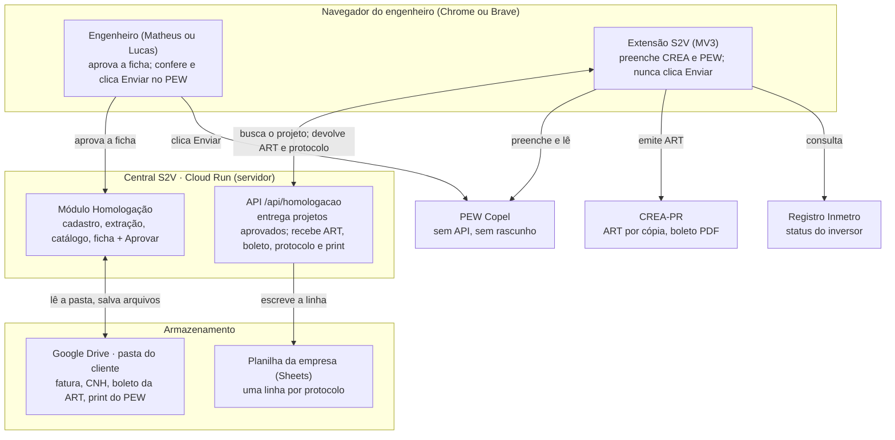

# Automação de homologação Copel + CREA — especificação para a Central S2V

Especificação técnica para implementar, dentro da Central S2V, a automação do protocolo de projetos de microgeração no **PEW da Copel** e da emissão de **ART no CREA-PR**.

Levantamento feito em 16/11/2026, acompanhando um projeto real do início ao fim: ART emitida, PEW preenchido e protocolado, planilha atualizada. Os dados pessoais de clientes foram removidos deste repositório e substituídos por valores de exemplo.

**Recomendação:** um módulo **Homologação** na Central (cadastro, extração, conferência, Drive e planilha) mais uma **extensão de navegador (Chrome ou Brave)** que preenche o PEW e o CREA na sessão já logada do engenheiro. O servidor nunca guarda senhas, e o envio à Copel continua sendo um clique humano.

## Sumário

1. [Recomendação](#recomendação)
2. [Decisões definidas](#decisões-definidas)
3. [Arquitetura](#arquitetura)
4. [Fluxo ponta a ponta](#fluxo-ponta-a-ponta)
5. [Modelo de dados](#modelo-de-dados)
6. [Regras de preenchimento](#regras-de-preenchimento)
7. [Detalhes técnicos dos portais](#detalhes-técnicos-dos-portais)
8. [Fases de implementação](#fases-de-implementação)
9. [Riscos e pontos em aberto](#riscos-e-pontos-em-aberto)

## Recomendação

A escolha é a opção B. O motivo decisivo é que **o PEW não salva rascunho**: o formulário só existe na aba aberta, e sair dele descarta tudo (aviso "Ao voltar, você perderá todos os dados"). Então o preenchimento precisa acontecer no mesmo navegador em que o engenheiro vai conferir e clicar em Enviar. Um robô no servidor preencheria uma sessão que ninguém consegue ver.

| Opção | Como funciona | Senhas | O engenheiro confere e envia no PEW? | Esforço | Veredito |
| --- | --- | --- | --- | --- | --- |
| A. Robô no servidor (Playwright no Cloud Run) | A Central abre PEW e CREA num navegador invisível | Guardadas no servidor (Secret Manager) | Não: o rascunho morre com a sessão do robô | Médio | Descartada |
| **B. Central + extensão do navegador** | A Central guarda e valida os dados; a extensão preenche as telas na sessão já logada | Nunca saem do navegador do engenheiro | Sim: o formulário fica preenchido na aba dele | Médio | **Recomendada** |
| C. Agente de IA no navegador | Claude opera o navegador seguindo esta especificação | Nunca saem do navegador | Sim | Baixo para começar | Ponte até a B ficar pronta |

A opção C foi usada para validar esta especificação num projeto real. Ela funciona sem código, mas é mais lenta e menos previsível que um script fixo, e serve de transição.

## Decisões definidas

Definidas pelo Matheus em 16/11/2026. Valem para todas as integradoras.

| Tema | Decisão | O que muda no sistema |
| --- | --- | --- |
| Responsável técnico | Dois engenheiros fazem os projetos: Matheus Cezario Serafim (CREA PR-200254/D) e Lucas (CREA PR-197267/D). Cada um tem login próprio no PEW e no CREA | O projeto tem o campo `responsavel_tecnico`, escolhido na ficha. A extensão roda no navegador de quem foi escolhido, copia uma ART anterior desse mesmo engenheiro e confere o nome logado antes de começar |
| Valor do contrato na ART | Sempre R$ 2.500,00 | Valor fixo na configuração, não editável na ficha |
| Pagamento da ART | Sempre boleto, salvo na pasta do projeto como `BOLETO ART <NOME>.pdf` | No modal PIX/Boleto do CREA, a extensão sempre escolhe Boleto |
| Modalidade | Padrão: Autoconsumo remoto | Vem pré-selecionada na ficha, com opção de trocar |
| Aumento do padrão de entrada | Alguns projetos incluem aumento do padrão. O PEW tem o campo "Alteração de carga da entrada de serviço (apenas BT)" | A ficha sempre pergunta "Haverá aumento do padrão?". Se Sim, pede o disjuntor desejado e a nova carga instalada (kW), e a extensão preenche esses campos no PEW. Se Não, marca Não |

Com "Alteração de carga" em **Sim**, o PEW mostra mais quatro campos na mesma aba:

| Campo do PEW | Tipo | Preenchimento |
| --- | --- | --- |
| Tipo de conexão atual | Leitura, vem da UC (ex. TRIFÁSICO) | Nenhum; a extensão só confere com a ficha |
| Disjuntor atual | Leitura, vem da UC (ex. 70 A) | Nenhum; a extensão só confere com a ficha |
| Disjuntor Desejado | Lista (ex. "Trifásico de 150 A") | `novo_padrao.disjuntor_desejado`, escolhido na ficha |
| Nova Carga Instalada (kW) | Número (ex. 57.16) | `novo_padrao.nova_carga_kw`, informado na ficha |

A lista "Disjuntor Desejado" traz todos os disjuntores da **NTC 901100** da Copel. A ficha deve oferecer a mesma lista, montada da tabela dessa norma (tipo de ligação + corrente, no formato "Trifásico de 150 A"). A extensão escolhe no PEW o item de texto idêntico e, se não encontrar, para e avisa, em vez de escolher o mais próximo.

O próprio PEW avisa que essa opção só calcula a nova potência máxima de geração. A alteração de carga em si é pedida à parte, nos canais de atendimento da Copel, com documentos, estudo de rede e custos, e tem de estar concluída antes da vistoria da GD. Por isso, quando a ficha marcar aumento de padrão, a Central cria a pendência "Solicitar alteração de carga na Copel" e só libera o pacote de vistoria depois que ela for concluída.

## Arquitetura



A Central nunca acessa PEW, CREA ou Inmetro: ela só guarda, valida e grava no Drive e na planilha. Tudo o que toca os portais roda na extensão, dentro do navegador (Chrome ou Brave) em que o engenheiro já está logado. Por isso não há senha de portal em servidor nenhum.

## Fluxo ponta a ponta

São 9 etapas e 3 portões humanos: a aprovação da ficha (que autoriza gastar R$ 108,39 de ART), o clique em **Enviar para aprovação** no PEW e o envio no WhatsApp. O sistema nunca executa nenhum deles.

| # | Etapa | Quem faz | Saída |
| --- | --- | --- | --- |
| 1 | Integradora cria a subpasta do cliente no Drive com fatura, CNH e texto do kit | Integradora | Pasta `PROJETOS TERCEIROS/<EMPRESA>/<CLIENTE>` |
| 2 | Central detecta a pasta nova e extrai os dados (UC, CPF, endereço, kit) | Central | Registro do projeto, status `rascunho` |
| 3 | Central resolve o catálogo (área do módulo pelo datasheet, nº Inmetro e status ativo) e roda as validações | Central | Ficha de conferência com alertas |
| 4 | **Portão 1:** o engenheiro responsável (Matheus ou Lucas) confere a ficha e aprova | Humano | Status `aprovado` |
| 5 | Extensão emite a ART por cópia no CREA, baixa o boleto e o salva na pasta | Extensão | `BOLETO ART <NOME>.pdf` + nº da ART no registro |
| 6 | Extensão preenche todas as abas do PEW, incluindo o nº da ART e o aceite, e para | Extensão | PEW preenchido, botão Enviar intocado |
| 7 | **Portão 2:** o engenheiro responsável confere e clica em Enviar para aprovação | Humano | Protocolo Copel |
| 8 | Extensão lê o protocolo, tira o print da tela de status, salva na pasta e atualiza a planilha da empresa | Extensão + Central | `PEW <NOME>.png`, linha na planilha |
| 9 | **Portão 3:** o engenheiro envia o print e o boleto no grupo de WhatsApp da integradora | Humano | Mensagem no grupo |

Depois da etapa 9, a Central acompanha o projeto: consulta o status no PEW, baixa o zip do orçamento quando aprovado, preenche a data de aprovação na planilha e avisa quando faltarem 20 dias para os 120 de validade do orçamento.

## Modelo de dados

Cada projeto é um registro único. A extensão só lê registros com status `aprovado` e só escreve de volta `art`, `pew` e `arquivos`. Valores pessoais abaixo são fictícios; os técnicos (módulo, inversor, área, Inmetro, taxa) são reais. Veja também [`exemplos/projeto.exemplo.json`](exemplos/projeto.exemplo.json).

```json
{
  "id": "1sol-2026-11-cliente-exemplo",
  "empresa": { "nome": "1SOL", "pasta_drive": "PROJETOS TERCEIROS/1SOL - ALISSON", "planilha_id": "<id da planilha HOMOLOGAÇÕES 1SOL>" },
  "status": "protocolado",
  "responsavel_tecnico": { "nome": "MATHEUS CEZARIO SERAFIM", "crea": "PR-200254/D" },
  "cliente": {
    "nome": "CLIENTE EXEMPLO", "cpf": "00000000000",
    "endereco": { "logradouro": "R EXEMPLO", "numero": "100", "bairro": "CENTRO", "cidade": "MARINGA", "uf": "PR", "cep": "87000000" }
  },
  "uc": { "codigo_fatura": "000000000", "numero_copel": "0.000.000.000-00", "ligacao": "BIFASICO", "tensao_v": 220, "disjuntor_a": 50 },
  "gd": {
    "modalidade": "AUTOCONSUMO_REMOTO", "grid_zero": false, "alteracao_carga": false,
    "novo_padrao": null,
    "dispensa_73a": false, "beneficiarias": []
  },
  "modulos": [ { "fabricante": "RONMA SOLAR", "modelo": "RM-620W-182R/132TB", "qtd": 9, "potencia_w": 620, "area_unit_m2": 2.7012, "fonte_area": "datasheet RM-600-630W-182R/132TB, 2382x1134 mm" } ],
  "inversores": [ { "fabricante": "GROWATT", "modelo": "MIN 5000TL-X2", "qtd": 1, "potencia_kw": 5.0, "inmetro": "003570/2024", "inmetro_status": "Ativo", "inmetro_verificado_em": "2026-11-16" } ],
  "calculado": { "kwp": 5.58, "kw_ca": 5.0, "area_total_m2": 24.31, "valor_projeto": 300.0 },
  "art": { "numero": "0000000000000", "copiada_de": "0000000000000", "valor_contrato": 2500.0, "inicio": "2026-11-16", "termino": "2026-12-16", "boleto_venc": "2026-11-26", "taxa": 108.39, "paga": false },
  "pew": { "protocolo": "00000000000000", "enviado_em": "2026-11-16", "status": "AGUARDANDO ANALISE", "email_adicional": "engenharia@s2vengenharia.com" },
  "arquivos": { "boleto_art": "BOLETO ART CLIENTE EXEMPLO.pdf", "print_pew": "PEW CLIENTE EXEMPLO.png" },
  "auditoria": [ { "em": "2026-11-16T16:15", "quem": "matheus", "acao": "aprovou_ficha" } ]
}
```

Com aumento de padrão, `alteracao_carga` fica `true` e `novo_padrao` recebe, por exemplo, `{ "disjuntor_desejado": "Trifásico de 150 A", "nova_carga_kw": 57.16 }`.

Decisões embutidas no modelo:

- **`kw_ca` vai para a ART e para o PEW**: é a soma dos inversores (5,00 kW no exemplo). **`kwp` vai para a planilha** (5,58 kWp).
- **`valor_projeto`** sai da tabela de faixas da própria planilha da integradora: 0 a 10 kWp = R$ 300; 10 a 20 = R$ 450; 20 a 40 = R$ 800; 40 a 60 = R$ 1.000; 60 a 80 = R$ 1.200; 80 a 100 = R$ 1.400; 100 a 125 = R$ 1.600. Os valores não incluem o custo da ART.
- **CPF e CNH são dados pessoais (LGPD)**. Os arquivos ficam só no Drive; o banco guarda os campos extraídos, e o acesso exige o login de administrador que a Central já tem. Não commitar dados reais de clientes neste repositório.

## Regras de preenchimento

Todas as regras foram observadas no trabalho real ou definidas pelo Matheus. Não há valor inventado. A ordem obrigatória é: **ART primeiro, PEW depois**. Assim o PEW não fica parado esperando o CREA e não cai por inatividade.

### Entrada: de onde vem cada dado

| Dado | Fonte | Regra de extração |
| --- | --- | --- |
| Código da UC | Fatura Copel (PDF) | Número de 9 dígitos no topo. O PEW converte sozinho para o formato 0.000.000.000-00 |
| Nome, endereço, CEP | Fatura Copel | Bloco "Nome / Endereço / CEP / Cidade" |
| Ligação e disjuntor | Fatura Copel | Ex. "B1 Residencial / Residencial Bifasico /50A" |
| CPF completo | CNH-e (PDF assinado) | Na fatura o CPF vem mascarado (`***.***.*00-00`), por isso a CNH é obrigatória. A CNH-e é imagem: exige OCR ou visão |
| Kit | Texto ou print no WhatsApp | Formato livre, ex. "09 de 620w Ronma - Growatt 5K". Pedir à integradora um formato fixo: `9x Ronma RM-620W-182R/132TB + 1x Growatt MIN 5000TL-X2` |
| Área do módulo | Datasheet do fabricante | Comprimento × largura. Ex. Ronma 2382 × 1134 mm = 2,70 m² por placa |
| Nº Inmetro (Growatt) | PDF "GROWATT – REGISTROS INMETRO 140-515" na pasta de certificados da Growatt no Drive | Tabela modelo → número. Reler quando sair revisão nova (a atual é de 28/10/2026) |
| Nº Inmetro (outras marcas) | Pesquisa na web + conferência no Inmetro | Abrir `registro.inmetro.gov.br/consulta/detalhe.aspx?NumeroRegistro=<nº>` e exigir status **Ativo** e o modelo como **Incluído** no histórico |

### CREA-PR: ART por cópia

| Campo | Valor |
| --- | --- |
| Origem | Gerenciamento → última ART do mesmo engenheiro responsável (de preferência da mesma integradora) → Mais ações → Copiar → Sim |
| Forma de registro / Participação / Vinculação | Inicial / Individual / Sem vinculação (vêm da cópia) |
| Empresa contratada | Autônomo, ou contratado por empresa não registrada no Crea-PR |
| Contratante (CPF e nome) | Titular da UC |
| Endereço do contratante | Endereço da fatura (o CEP preenche cidade, logradouro e bairro; o número é digitado) |
| Data do contrato e data de início | Dia da emissão |
| Previsão de término | Início + 1 mês |
| Valor do contrato e custo da obra | R$ 2.500,00 (fixo) |
| Proprietário | Botão "Copiar nome/documento do contratante" |
| Endereço da obra | Excluir o endereço copiado → "Copiar endereço do contratante" → Salvar endereço |
| Atividade | "Execução de instalação, Projeto de instalações • de microgeração distribuída", quantidade = `kw_ca` em KW |
| Finalização | Verificar pendências → Ver resumo → declaração do art. 299 → "Dados conferidos. Finalizar ART e realizar pagamento" → **Boleto** → Confirmar |
| Boleto | Abre em aba nova (PDF). Salvar como `BOLETO ART <NOME DO CLIENTE>.pdf` na pasta do cliente |

### PEW Copel: Projeto → Incluir Geração Distribuída

| Aba | Campo | Valor |
| --- | --- | --- |
| Validar | Unidade consumidora | `codigo_fatura` → Pesquisar → Confirmar |
| Dados da UC | (todos) | Nada a preencher: vêm da base da Copel |
| Titular | CPF | `cliente.cpf` → Pesquisar |
| Titular | E-mail adicional | Sempre `engenharia@s2vengenharia.com` |
| Tipo Geração | Tipo / Fonte | Solar / Radiação solar |
| Tipo Geração | Grid Zero / Dispensa 73-A | Não / Não |
| Tipo Geração | Modalidade | `gd.modalidade`, padrão Autoconsumo remoto, trocável na ficha |
| Tipo Geração | Alteração de carga da entrada de serviço (apenas BT) | Não por padrão; Sim com aumento de padrão (ver Decisões definidas) |
| Sistema | Placas (Incluir placa) | Fabricante, modelo, quantidade, área total (m², do datasheet), potência individual (W) |
| Sistema | Inversores (Incluir inversor **Inmetro**) | Fabricante, modelo, quantidade, potência individual (kW), nº Inmetro |
| Resp. técnica | Número ART/TRT | `art.numero` |
| Resp. técnica | Aceite | Marcar o checkbox do Termo de Aceite |
| — | **Enviar para aprovação** | **Nunca clicar. Exclusivo do engenheiro responsável** |

### Planilha da empresa (ex. HOMOLOGAÇÕES 1SOL)

| Coluna | Valor no protocolo |
| --- | --- |
| Linha | Abaixo da faixa amarela do mês (`01/MM/AAAA` formatado como "mês/ano"). Se a faixa do mês não existir, criar copiando a do mês anterior |
| B Nome cliente | Nome do titular, com sufixo "(autoconsumo)" quando houver beneficiária |
| C Potência projeto | `kwp` no formato `5,58KWP` |
| D Data homologação | Data do protocolo |
| E Protocolo homologação | `pew.protocolo` |
| F a I | Ficam em branco até aprovação e vistoria |
| J Status projeto | Chip "Pendente" (vira "Finalizado" após a vistoria) |
| K Valor projeto | `valor_projeto` da tabela de faixas |
| L Pagamento | Chip "PENDENTE" |

Técnica que funcionou: copiar a última linha preenchida para a linha nova e trocar só os valores. Isso preserva os chips e a formatação. Pela API do Sheets, o equivalente é `copyPaste` com `PASTE_NORMAL` seguido de `values.update`.

## Detalhes técnicos dos portais

Os IDs e caminhos abaixo foram lidos nas telas reais em 16/11/2026. Onde está escrito "a mapear", o elemento existe mas o ID não foi capturado. Os portais mudam sem aviso, então cada seletor deve ficar num único arquivo de configuração por portal.

### Navegadores: Chrome e Brave

A mesma extensão roda nos dois navegadores, sem código separado. O Brave é baseado no Chromium e aceita extensões Manifest V3 instaladas pela Chrome Web Store ou carregadas em modo desenvolvedor (`brave://extensions` → Modo do desenvolvedor → Carregar sem compactação). Três cuidados:

- **Autenticação sem `chrome.identity`:** o Brave não oferece o login Google dessa API (`getAuthToken`). A extensão se autentica na Central com um token pessoal gerado na própria Central, um por engenheiro, sem depender de login Google nem de cookie de sessão.
- **Brave Shields:** bloqueia cookies de terceiros e rastreadores. As chamadas à API da Central saem do service worker da extensão, com `host_permissions` para o domínio da Central, e por isso não são afetadas. Se a aba do boleto do CREA não abrir, liberar pop-ups para `servicos.crea-pr.org.br` nos Shields.
- **Distribuição:** publicar como item não listado na Chrome Web Store, que instala igual no Chrome e no Brave e atualiza sozinho. A alternativa é distribuir a pasta da extensão para carregar em modo desenvolvedor. Antes de liberar cada fase, rodar o fluxo completo nos dois navegadores.

### PEW Copel (JSF + PrimeFaces, versão 2.51.0)

- **Páginas:** inclusão em `/pewweb/paginas/projetoGdSolar.jsf`; consulta em `/pewweb/paginas/consultaProjetosGdSolar.jsf`; vistoria em `/pewweb/paginas/servico/solicitacaoVistoria.jsf`. Depois do envio, a URL passa a ter `?id=<n>&passo=tab-status-solicitacao-0`, e o protocolo aparece no topo, ao lado de "PROJETO AGUARDANDO ANÁLISE".
- **IDs confirmados:** `form:cpfUCProp`, `form:emailAdicional`, `form:tbPlaca:0:fabricantePlaca`, `form:tbPlaca:0:modeloPlaca`, `form:numeroArtTrt`, `form:cienteGdSolar_input` (o checkbox real fica oculto; é preciso clicar na caixa visual do PrimeFaces). Os campos da UC (`form:sitUCProp`, `form:faseUCProp`, `form:disjuntorUCProp`, `form:subestacao`, `form:alimentador`) servem para ler e conferir.
- **A mapear:** os campos de quantidade, área e potência da placa (`form:tbPlaca:0:*`), os da linha do inversor Inmetro, os `selectOneMenu` da aba Tipo Geração (`form:tipoGeracaoMenu` e os demais) e os campos de aumento de padrão (Disjuntor Desejado, Nova Carga Instalada).
- **Dropdowns PrimeFaces:** mudar o `<select>` oculto não dispara o AJAX. É preciso usar o widget (`PF('<widgetVar>').selectValue(v)`) ou abrir a lista e clicar no item. "Fonte Primária" só é carregada depois que "Tipo Geração" muda.
- **Linhas de placa e inversor:** "Incluir placa" e "Incluir inversor Inmetro" criam uma linha editável, confirmada pelo ✔ verde. O PEW calcula a potência total e mostra "Potência total de geração na unidade consumidora". Esse total deve ser lido e comparado com `kw_ca`.
- **Armadilha 1:** voltar a uma aba anterior **apaga o nº da ART e o aceite** da última aba. Preencher em ordem e deixar a responsabilidade técnica por último. Se houver correção, repreencher os dois.
- **Armadilha 2:** existe timeout por inatividade e a sessão expira, caindo na tela de login. O login é sempre do usuário; a extensão detecta a tela de login e pausa.
- **Armadilha 3:** o PEW não salva rascunho. "Voltar" pergunta "Ao voltar, você perderá todos os dados". A extensão nunca clica em Voltar.
- **Trava de segurança:** a extensão deve envolver o botão "Enviar para aprovação" e o diálogo "Apresentar solicitação de conexão" num bloqueio. Nenhum código da extensão pode dispará-los. Testar isso de forma automatizada.

### CREA-PR (área restrita)

- **Rotas:** lista em `/restrito/art/gerenciamento`; visualização em `/restrito/art/<idInterno>`; edição em `/restrito/art/obra-servico?artId=<idInterno>`. O número público da ART (13 dígitos) é diferente do `idInterno` (8 dígitos).
- **Abas do assistente:** Dados Gerais → Contrato → Endereços → Atividades Técnicas → Verificar pendências. Cada "Próximo" salva ("Art salva com sucesso").
- **IDs confirmados na aba Contrato:** `documentoContratante`, `dataContrato`, `dataPrevistaInicio`, `dataPrevistaConclusao`, `ddd`, `telefone`, `email`. O nome do contratante e os campos de endereço não têm id e devem ser localizados pelo rótulo ("Nome civil", "CEP", "Número").
- **CPF:** ao sair do campo CPF, o foco vai para o nome, que não é preenchido sozinho; é preciso digitá-lo. O CEP preenche cidade, logradouro e bairro pelo botão Buscar.
- **Pagamento:** o modal oferece PIX ou Boleto, e a escolha é irreversível ("esta opção não poderá ser alterada"). Escolher sempre Boleto. O boleto abre em `/reports/print.aspx?...` como PDF; a extensão faz `fetch` da URL e envia o blob para a Central.
- **ARTs órfãs:** existem ARTs "Cadastradas" nunca pagas, criadas em tentativas anteriores. A extensão deve reaproveitar uma ART "Preenchida" do mesmo CPF em vez de criar outra.

### Inmetro

- A página de detalhe `registro.inmetro.gov.br/consulta/detalhe.aspx?pag=1&NumeroRegistro=003570/2024` mostra status, data de concessão, empresa, nome de família e histórico de modelos.
- A busca por "Marca / Modelo" (`Default.aspx?acao=pesquisar&MarcaModelo=...`) retornou "Nenhum registro encontrado" e depois página de erro. Não usar.
- O `robots.txt` do Inmetro bloqueia acesso automatizado pelo servidor. A checagem deve rodar na extensão (navegador do usuário) ou ser manual.

### Pasta no Drive (padrão atual)

- `<CLIENTE>/` contém: fatura, CNH, fotos do WhatsApp, `BOLETO ART <NOME>.pdf`, `ART <NOME>.pdf` (impressa depois de paga), formulário, orçamento e relacionamento operacional (do zip do PEW), `COPEL ASSINADO.pdf`, `ART ASSINADO.pdf`.
- Rehomologação vai para a subpasta `NOVA HOMOLOGAÇÃO/` (às vezes `NOVO PROJETO/` ou `NOVA NOVA HOMOLOGAÇÃO/`). Padronizar o nome dessa subpasta faz parte da fase 1.

## Fases de implementação

São cinco fases, cada uma entregável sozinha. A fase 1 já tira do engenheiro a digitação repetida e a planilha, mesmo antes de existir a extensão.

| Fase | Entrega | Onde | Pronto quando |
| --- | --- | --- | --- |
| 1. Módulo Homologação na Central | Cadastro do projeto, upload ou leitura da pasta do Drive, extração de fatura e CNH, catálogo (área + Inmetro), ficha de conferência com botão Aprovar, escrita da linha na planilha da empresa | Central (Cloud Run) | Um projeto real, recadastrado do zero, gera ficha idêntica às tabelas de Regras |
| 2. Extensão: PEW | Botão "Preencher PEW" que busca o projeto aprovado na API da Central e preenche todas as abas; trava no Enviar | Extensão MV3 (Chrome e Brave) | Preenche 3 projetos reais com zero correção manual e nunca clica em Enviar (teste automatizado) |
| 3. Extensão: CREA | Emissão da ART por cópia, captura do número e do boleto PDF, envio para a pasta do cliente | Extensão + Central | ART e boleto batem com o padrão das ARTs de out/nov 2026 |
| 4. Pós-protocolo | Leitura do protocolo, print da tela (`chrome.tabs.captureVisibleTab`), atualização da planilha e da pasta | Extensão + Central | Print e linha da planilha iguais aos feitos à mão |
| 5. Acompanhamento | Consulta periódica do status no PEW, download do zip do orçamento, data de aprovação na planilha, alerta de validade (120 dias), pendência de alteração de carga, pacote de vistoria | Extensão (sob demanda) + Central | Nenhum projeto aprovado fica sem registro na planilha por mais de 1 dia |

### Contrato entre Central e extensão (API mínima)

| Método | Rota | Uso |
| --- | --- | --- |
| GET | `/api/homologacao/projetos?status=aprovado` | A extensão lista o que está pronto para preencher |
| GET | `/api/homologacao/projetos/<id>` | Registro completo (modelo de dados acima) |
| POST | `/api/homologacao/projetos/<id>/art` | Grava o número da ART e recebe o PDF do boleto, que a Central salva no Drive |
| POST | `/api/homologacao/projetos/<id>/protocolo` | Grava o protocolo e recebe o PNG do print. A Central salva no Drive e escreve na planilha |
| POST | `/api/homologacao/projetos/<id>/status` | Atualizações da fase 5 (aprovado, zip do orçamento) |

A autenticação usa um token pessoal por engenheiro, gerado na Central (ver Navegadores). Quanto ao código existente, o formulário do **Unifilar** da Central já pede cliente, UC, endereço, módulo, inversor e ART, e tem um catálogo de equipamentos. O módulo Homologação deve reaproveitar esse catálogo e esses dados, para o cliente ser digitado uma única vez na Central.

## Riscos e pontos em aberto

Os pontos de negócio foram decididos em 16/11/2026 (ver Decisões definidas). O que sobra são riscos operacionais, cada um com o tratamento previsto.

| Ponto | Situação observada | Tratamento |
| --- | --- | --- |
| ART não quitada no protocolo | O termo do PEW declara ART "quitada", mas o protocolo sai no mesmo dia do boleto | Decidido: manter o fluxo atual. A ART é sempre emitida por boleto e salva na pasta, e o PEW é protocolado no mesmo dia. A fase 5 avisa quando um boleto passar do vencimento sem pagamento |
| Engenheiro errado logado | Matheus e Lucas têm cada um seu login no PEW e no CREA. O PEW exige a ART em nome do responsável técnico cadastrado nele | Antes de digitar, a extensão compara o nome logado no PEW ("Bem-vindo(a) …") e no CREA com o responsável técnico do projeto, e para se não bater |
| Inversor ambíguo | "Growatt 5K" serve tanto para o MIN 5000TL-X2 (on-grid) quanto para o SPF 5000ES (off-grid) | A ficha bloqueia a aprovação enquanto o modelo exato não estiver confirmado |
| Mudança de layout dos portais | PEW e CREA não têm API nem aviso de mudança | Seletores num arquivo de configuração por portal; a extensão confere a tela antes de digitar e para se algo não bater |
| Protocolos desatualizados na planilha | Alguns projetos têm na planilha protocolos diferentes dos documentos da pasta (rehomologações) | Na fase 1, importar a pasta e marcar as divergências para o engenheiro corrigir |
| Envio no WhatsApp | O engenheiro prefere enviar ele mesmo o print e o boleto no grupo | Fica fora do escopo. A Central só deixa os dois arquivos prontos na pasta |

**Regras que não mudam em nenhuma fase:**

- **Senhas:** nenhuma senha de PEW, CREA ou gov.br sai do navegador do engenheiro.
- **Envio ao PEW:** o clique em Enviar para aprovação é sempre do engenheiro responsável pelo projeto (Matheus ou Lucas).
- **Rastreabilidade:** todo valor preenchido tem fonte registrada no projeto (fatura, CNH, datasheet, registro Inmetro, tabela de preços).
